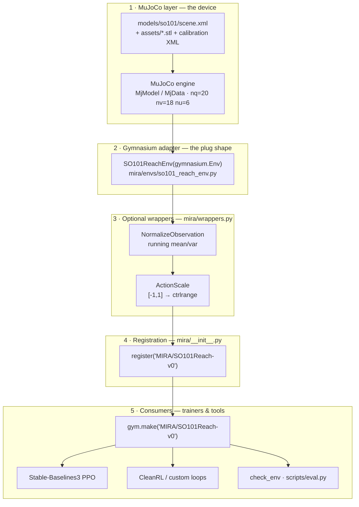
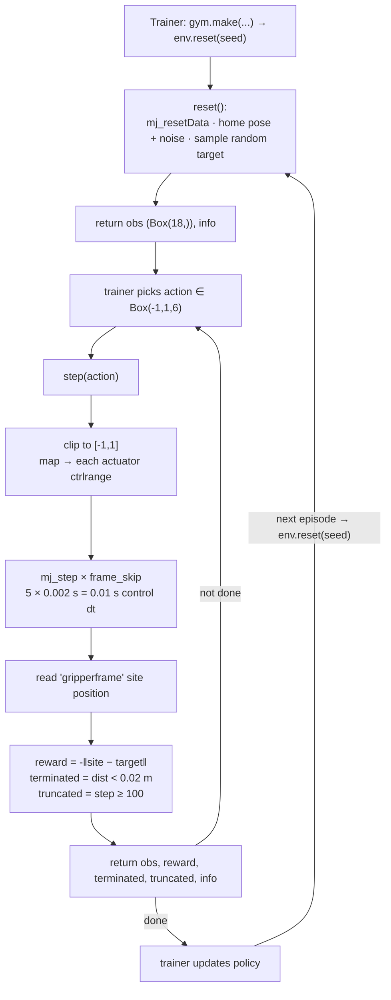

# Gymnasium in MIRA — what it is and how to use it

## What Gymnasium does (in one paragraph)

Gymnasium is the **standard interface for reinforcement-learning environments**. Instead of teaching a training algorithm how to talk to MuJoCo, you wrap your simulation in a tiny, fixed API — `reset()` and `step()` — and every RL library (Stable-Baselines3, CleanRL, …) already knows how to talk to it. Think of it as a **power adapter**: MuJoCo is the device, Gymnasium is the plug shape that all RL trainers expect.

In this project, `mira/envs/so101_reach_env.py` is that adapter. It loads `models/so101/scene.xml` into MuJoCo and exposes the arm as a standard RL environment called **`MIRA/SO101Reach-v0`**.

## Where Gymnasium fits — flowchart

Gymnasium is the **middle layer** of the project. MuJoCo knows nothing about RL and RL trainers know nothing about MuJoCo — Gymnasium is the shared language they both speak. Everything below it is simulation; everything above it is a training/eval consumer that was written once and works with *any* Gymnasium env.



| Layer | What it is | In MIRA |
|---|---|---|
| 1 · MuJoCo | Physics engine + MJCF model | `models/so101/scene.xml` loaded into `mujoco.MjModel`/`MjData` |
| 2 · Adapter | A class subclassing `gymnasium.Env` | `SO101ReachEnv` — translates MJCF state ⇄ `obs`, and action ⇄ `data.ctrl` |
| 3 · Wrappers | `gymnasium.ObservationWrapper` / `ActionWrapper` (optional) | `NormalizeObservation`, `ActionScale` |
| 4 · Registration | Registers the env under a string id | `mira/__init__.py` → `MIRA/SO101Reach-v0` |
| 5 · Consumers | Code that only knows the Gymnasium API | SB3, CleanRL, `check_env`, future `scripts/train.py` |

### One episode, end to end



**Reading the flowcharts:** the only bespoke code MIRA owns is layers 2–4 (the adapter, the wrappers, and the registration). Everything in layer 5 is off-the-shelf RL tooling that arrives via `requirements-rl.txt`. That separation is the whole point — because `SO101ReachEnv` obeys the Gymnasium contract, swapping MuJoCo for real hardware later only touches layer 1, and adding a new trainer (SAC, BC, a VLA policy) only touches layer 5.

## The contract every Gymnasium env follows

```python
obs, info = env.reset()                                  # start a new episode
obs, reward, terminated, truncated, info = env.step(act)  # advance one step
env.close()
```

| Concept | Meaning in MIRA |
|---|---|
| `observation_space` | `Box(18,)` — `[arm_qpos(6), arm_qvel(6), ee_pos(3), target(3)]` |
| `action_space` | `Box(-1, 1, shape=(6,))` — one number per arm joint, normalized |
| `reward` | `-‖gripper_site − target‖` — closer to the target is better (higher) |
| `terminated` | `True` when the gripper is within **2 cm** of the target (success) |
| `truncated` | `True` at **100 steps** (the time limit) |
| `info` | `{"distance", "is_success", "target"}` — diagnostics for logging/debug |

One control step = `timestep × frame_skip` = `0.002 × 5` = **0.01 s** of simulated time.

## How to use it

### 1. Minimal example

```python
import gymnasium as gym
import mira  # importing the package registers "MIRA/SO101Reach-v0"

env = gym.make("MIRA/SO101Reach-v0")
obs, info = env.reset(seed=0)

done = False
while not done:
    action = env.action_space.sample()          # random action in [-1, 1]^6
    obs, reward, terminated, truncated, info = env.step(action)
    done = terminated or truncated

print("final distance:", info["distance"], "success:", info["is_success"])
env.close()
```

### 2. Without `gym.make` (direct class)

```python
from mira import SO101ReachEnv

env = SO101ReachEnv(frame_skip=5, max_episode_steps=100, success_threshold=0.02)
```

`gym.make` returns the env wrapped in Gymnasium's standard safety wrappers; the
direct class is the bare env (useful for `check_env` or debugging).

### 3. Run the built-in smoke test

```bash
python3 mira/envs/so101_reach_env.py     # check_env + 10,000-step random rollout
python3 -m mira.envs.so101_reach_env     # equivalent
```

## Optional wrappers (`mira/wrappers.py`)

```python
from mira import SO101ReachEnv
from mira.wrappers import NormalizeObservation, ActionScale

env = SO101ReachEnv()

# Running mean/variance normalization — usually helps neural nets learn faster.
env = NormalizeObservation(env)

# (Optional) turn the [-1,1] action into raw joint targets if your trainer needs it.
from gymnasium import spaces
import numpy as np
env = ActionScale(env, spaces.Box(low=env.unwrapped.ctrl_low,
                                  high=env.unwrapped.ctrl_high, dtype=np.float64))
```

## Two project-specific gotchas (important)

1. **The scene is not arm-only.** `scene.xml` includes the two free-joint props
   (`coffee_cup`, `marshmallow`), so the MuJoCo model has `nq=20`, `nv=18`.
   The env therefore reads the **6 arm joints by name** — never index `qpos[:6]`.
2. **Gripper convention.** LeRobot treats the gripper as linear (`0` = closed,
   `100` = open), but the MJCF models it as a hinge. The env maps the action to
   each actuator's `ctrlrange`, so the LeRobot convention is preserved at the
   action boundary (`-1` → closed, `+1` → open).

## Where this fits the roadmap

This is **Phase 1 (Reach)** of `docs/RL_ROADMAP.md`. Because the env obeys the
Gymnasium contract, the next step is dropping a real trainer on top — e.g.
Stable-Baselines3 (SB3), added via a separate `requirements-rl.txt` so the lean
simulation image stays free of `torch`:

```python
# once requirements-rl.txt is installed
from stable_baselines3 import PPO
model = PPO("MlpPolicy", "MIRA/SO101Reach-v0")
model.learn(total_timesteps=100_000)
```
